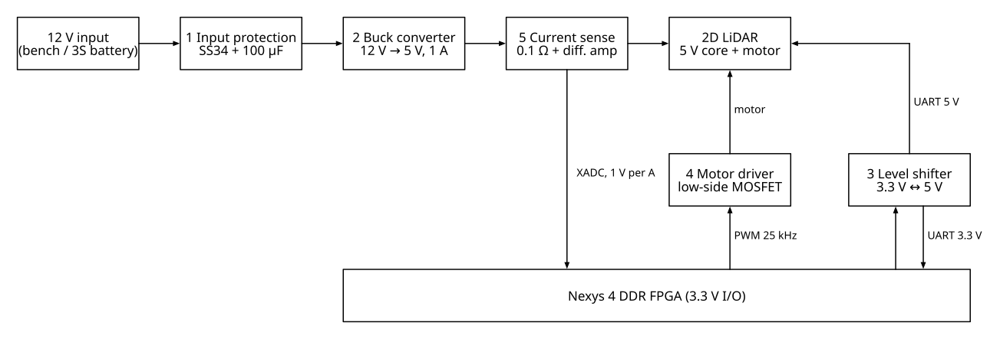
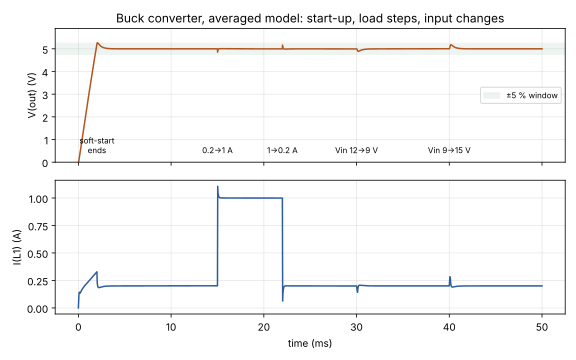
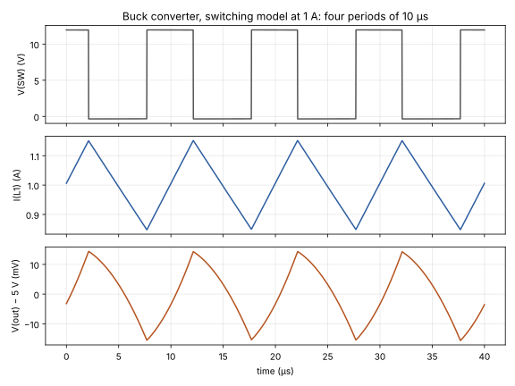

# LiDAR Power Board

**Electronics course project** · University of Debrecen, Faculty of Informatics · LTspice / ngspice · Python

The analog board that sits between a 12 V supply, a 2D LiDAR sensor and a Nexys 4 DDR FPGA. It powers the sensor, lets the FPGA control the scan motor, translates the UART logic levels and measures the current the sensor draws. Each block uses one part of the Electronics course, and every block is checked by simulation against written limits.

- [x] All five blocks designed, with the equations in [`calc/design.py`](calc/design.py)
- [x] Verified in simulation: `python3 sim/run_all.py` gives **32/32 checks passed** ([saved output](docs/sim_results.txt))
- [ ] Sensor model to be confirmed (see [assumptions](#assumptions))
- [ ] Hardware build on a prototype board



## The five blocks

| # | Block | What it does | Course topic | Key result (simulated) |
| --- | --- | --- | --- | --- |
| 1 | Input protection | Schottky diode in series and a 100 µF bulk capacitor | Diodes and rectifiers | 11.7 V left for the buck, 0.13 W loss; reversed input lets only 20 µA through |
| 2 | Buck converter | 12 V → 5 V at up to 1 A, 100 kHz, voltage-mode control with a type III error amplifier | DC-DC converters, op-amps, PWM | 5.004 V, 30 mV ripple, **94.1 % efficient**, 65° phase margin |
| 3 | Level shifter | Bidirectional 3.3 V ↔ 5 V UART with one MOSFET per line | MOS transistors | Works both ways at 115 200 baud, 0.9 µs rise time |
| 4 | Motor driver | Low-side logic-level MOSFET switched by a 25 kHz PWM from the FPGA | MOSFET as a switch, PWM | 0–300 mA motor current, drain clamped at 5.26 V, 5 mW loss |
| 5 | Current sense | 0.1 Ω shunt and a difference amplifier with gain 10 into the FPGA's XADC | Op-amp applications | 1.000 V at 1 A, 0.200 V at 0.2 A |

## Results

The buck converter is checked in two ways. The **averaged model** replaces the switch with its average over one period, so it can run 50 ms: soft-start, a load step from 0.2 A to 1 A and back, and input changes to 9 V and 15 V. The **switching model** runs the real 100 kHz switch to measure the ripple and the efficiency.

| Test | Limit | Result |
| --- | --- | --- |
| Output at 0.2 A and 1 A, at 9, 12 and 15 V input | 4.95–5.05 V | 4.999 V in all five cases |
| Dip after a 0.2 → 1 A load step | ≥ 4.75 V | 4.854 V |
| Peak after a 1 → 0.2 A load step | ≤ 5.25 V | 5.163 V |
| Start-up overshoot | ≤ 5.5 V | 5.27 V, reaches 4.95 V at 1.9 ms |
| Output ripple at 1 A | ≤ 50 mV p-p | 30.5 mV p-p |
| Coil current ripple | 0.2–0.4 A | 0.304 A (design: 0.3 A) |
| Efficiency at 1 A | ≥ 88 % | 94.1 % (5.007 W out, 5.319 W in) |
| Loop crossover and phase margin, 5 mA to 1 A | PM ≥ 45° | 14.3–14.6 kHz, 65–67° |





More plots and every schematic are in the [project guide](docs/PROJECT_GUIDE.md).

## Running the simulations

**LTspice** (as in the course labs): File → Open, choose *Netlists (\*.cir)* as the file type, open any file in [`sim/`](sim), and press Run. The measured values appear in View → SPICE Error Log.

**ngspice and Python** (self-checking):

```bash
pip install -r requirements.txt     # numpy, matplotlib, schemdraw
sudo apt install ngspice            # or: brew install ngspice
python3 sim/run_all.py              # runs every netlist and checks 32 limits
python3 calc/design.py              # prints the design table, draws the Bode plot
python3 docs/figures.py             # redraws the schematics and plots
```

## Repository layout

| Path | Contents |
| --- | --- |
| [`sim/`](sim) | Six SPICE netlists (one per block, two for the buck), `run_all.py` and its saved output |
| [`calc/design.py`](calc/design.py) | Every component value from its equation, and the loop-gain check |
| [`docs/PROJECT_GUIDE.md`](docs/PROJECT_GUIDE.md) | How each block works, why each value was chosen, the schematics and plots |
| [`docs/design_table.md`](docs/design_table.md) | The design table that `design.py` writes |
| [`hardware/BOM.csv`](hardware/BOM.csv) | Parts list with example part numbers |

## Assumptions

The sensor model is not fixed yet. The design assumes a typical 2D scanning LiDAR: 5 V supply, up to 1 A including the motor start-up, a DC scan motor of about 10 Ω, and a UART at 115 200 baud with 5 V logic. If the sensor already has 3.3 V logic, block 3 is bypassed; if it has its own motor-control input, the FPGA's PWM drives that pin directly.

## Related projects

This board is the analog part of a LiDAR project chain: the FPGA reads the sensor over UART, controls the motor speed with PWM and logs the current through the XADC. See also [fpga-mac-neuron](https://github.com/HannaBeshoy/fpga-mac-neuron) and [tablet-bottling-fpga](https://github.com/HannaBeshoy/tablet-bottling-fpga).
