# Project guide: LiDAR Power Board

This guide explains every block of the board: what it does, how each value was chosen, which part of the Electronics course it uses, and what the simulation shows. All numbers come from [`calc/design.py`](../calc/design.py) and [`sim/run_all.py`](../sim/run_all.py); the full design table is in [`design_table.md`](design_table.md).

## Contents

1. [Requirements](#1-requirements)
2. [Block 1: input protection](#2-block-1-input-protection)
3. [Block 2: buck converter](#3-block-2-buck-converter)
4. [Block 3: level shifter](#4-block-3-level-shifter)
5. [Block 4: motor driver](#5-block-4-motor-driver)
6. [Block 5: current sense](#6-block-5-current-sense)
7. [Verification summary](#7-verification-summary)
8. [Using the netlists in LTspice](#8-using-the-netlists-in-ltspice)
9. [Building the board](#9-building-the-board)
10. [Course topic map](#10-course-topic-map)

## 1. Requirements

| Quantity | Value | Why |
| --- | --- | --- |
| Input | 12 V nominal, 9–15 V | Bench supply, or a 3S Li-ion battery from full (12.6 V) to nearly empty |
| Output | 5 V ± 5 %, up to 1 A | A typical 2D LiDAR: sensor core plus scan motor, with margin for motor start-up |
| Logic | FPGA 3.3 V, sensor 5 V | Nexys 4 DDR I/O banks are 3.3 V |
| UART | 115 200 baud | The usual rate for 2D LiDAR sensors; one bit lasts 8.68 µs |
| Motor | PWM from the FPGA | So the FPGA can hold the scan speed constant |
| Current | measured by the FPGA | The XADC input on the JXADC header accepts 0–1 V |

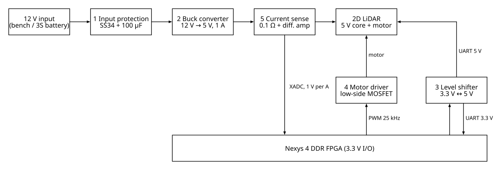

## 2. Block 1: input protection

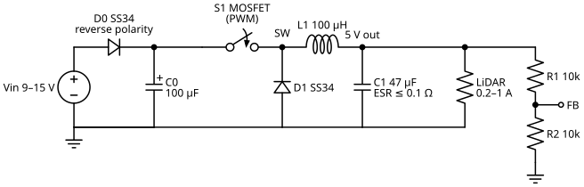

**What it does.** A Schottky diode D0 in series with the input. If the supply is connected the wrong way round, D0 is reverse biased and blocks; nothing downstream sees a negative voltage. C0 (100 µF) holds the input voltage steady when the buck converter draws its pulsed current.

**Why a Schottky diode.** It drops about 0.35–0.4 V instead of 0.7 V for a silicon diode, so it wastes about half as much power. The buck converter draws about 5.3 W, which is 0.45 A at 12 V:

```
P(D0) = VD · Iin ≈ 0.3 V · 0.45 A ≈ 0.13 W
```

**Simulation** ([`input_protection.cir`](../sim/input_protection.cir)): connected correctly, 11.7 V reaches the buck and D0 dissipates 0.134 W. Connected reversed, only 20 µA of leakage flows.

**Course link:** Topic 4, the diode as a switch controlled by the polarity of its voltage.

## 3. Block 2: buck converter

### 3.1 Power stage

The switch S1 connects the coil to the input for a fraction D of each 10 µs period. The rest of the time the coil current flows on through the diode D1. The LC filter keeps only the average of the switch-node voltage, so:

```
Vout + VD = D · (Vin + VD)    →    D = (5 + 0.35) / (12 + 0.35) = 0.43
```

At 9 V the duty cycle rises to 0.57; at 15 V it falls to 0.35. The feedback loop sets it automatically.

**Inductor.** During the on-time the coil sees Vin − Vout, so its current rises by:

```
ΔIL = (Vin − Vout) · D / (f · L)
```

For a ripple of 30 % of 1 A (0.3 A) at 100 kHz this gives L = 101 µH, so **100 µH** is chosen. The coil must not saturate below 1 A + 0.15 A; a 1.5 A part leaves margin. The worst case is 15 V input, where ΔIL = 0.35 A.

**Output capacitor.** The capacitor absorbs the ripple current. Its capacitance alone would need only 19 µF for 20 mV ripple, but the ESR adds ΔIL · ESR = 30 mV with a 0.1 Ω capacitor. **47 µF** with ESR ≤ 0.1 Ω is chosen; the simulation shows 30.5 mV peak-to-peak, which matches the ESR estimate.

| Element | Value | Main equation |
| --- | --- | --- |
| Switching frequency | 100 kHz | — |
| L1 | 100 µH | (Vin − Vout)·D / (f·ΔIL) |
| C1 | 47 µF, ESR 0.1 Ω | ΔV ≈ ΔIL·ESR + ΔIL/(8·f·C) |
| LC resonance | 2.32 kHz | 1 / (2π√(LC)) |
| ESR zero | 33.9 kHz | 1 / (2π·ESR·C) |
| Schottky D1 loss | 0.20 W | VD·Iout·(1 − D) |

### 3.2 Control loop

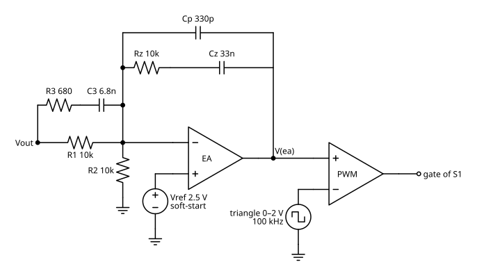

The divider R1 = R2 = 10 kΩ halves the output, and the error amplifier (EA) compares it with a 2.5 V reference, so the output settles at exactly 2 × 2.5 V = 5 V. The EA output V(ea) goes to a comparator together with a 0–2 V, 100 kHz triangle. The comparator output is high while V(ea) is above the triangle, so the duty cycle is D = V(ea) / 2 V. This is the PWM modulator from Topic 11.

**Why type III compensation.** The LC filter has a double pole at 2.3 kHz that turns the phase by 180°. Without compensation the loop would oscillate. The type III network around the EA adds:

| Part of the network | Frequency | Job |
| --- | --- | --- |
| Integrator (Cz, Cp with R1) | from DC | Zero steady-state error, so 4.999 V instead of 4.9 V |
| Zero 1: Rz·Cz | 482 Hz | Starts adding phase before the LC double pole |
| Zero 2: (R1 + R3)·C3 | 2.2 kHz | Second zero, at the LC double pole |
| Pole 1: R3·C3 | 34 kHz | Cancels the capacitor's ESR zero |
| Pole 2: Rz·Cp | 48 kHz | Removes switching noise (about half of 100 kHz) |

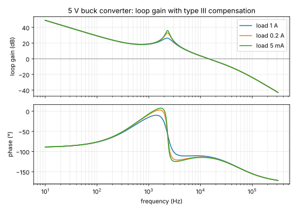

The loop crosses 0 dB at 14.3–14.6 kHz, about one seventh of the switching frequency, with 65–67° of phase margin from 5 mA to 1 A. At least 45° is the usual target; more margin means less overshoot after a load step.

**Soft-start.** The reference rises from 0 to 2.5 V in 2 ms. Without it, the output capacitor would charge with a large current spike and the output would overshoot well above 5.5 V, the usual absolute maximum of 5 V sensors.

### 3.3 Two simulation models

| Model | File | What it is good for |
| --- | --- | --- |
| Averaged | [`buck_averaged.cir`](../sim/buck_averaged.cir) | The switch and diode are replaced by a voltage source equal to their average over one period: V(sw) = D·Vin − (1 − D)·VD. No 100 kHz detail, so 50 ms runs in seconds. Used for start-up, load steps and input changes. |
| Switching | [`buck_switching.cir`](../sim/buck_switching.cir) | The real triangle, comparator, switch and Schottky diode. Shows ripple, coil current and losses. Starts near steady state so 3 ms is enough. |

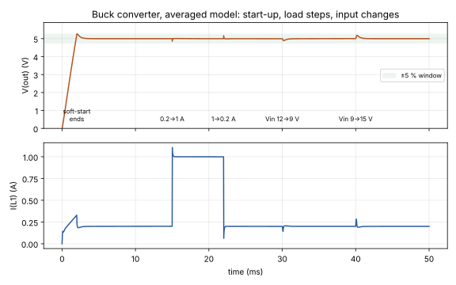

The load step from 0.2 A to 1 A at 15 ms makes the output dip by 146 mV (to 4.854 V). It is back within 20 mV of 5 V after 0.1 ms. Removing the load at 22 ms makes it rise by 163 mV. Both stay inside the ±5 % window.

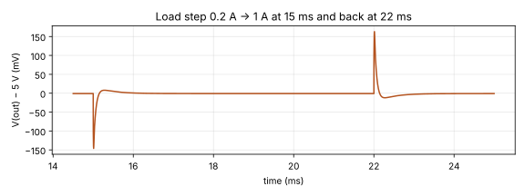

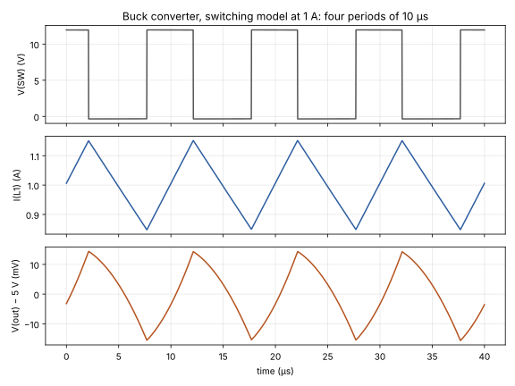

The switching model at 1 A shows the triangle-shaped coil current (0.85–1.15 A, ΔIL = 0.304 A) and 30.5 mV output ripple. Input power 5.319 W and output power 5.007 W give **94.1 % efficiency**. A linear regulator would reach only 5 / 12 = 42 % and would have to dissipate 7 W.

**Course link:** Topic 6 (buck converter, volt-second balance, ripple), Topics 7–8 (op-amp, integrator, Bode plot), Topic 11 (comparator and PWM), Lab test 1 (the LT1578 buck regulator).

## 4. Block 3: level shifter

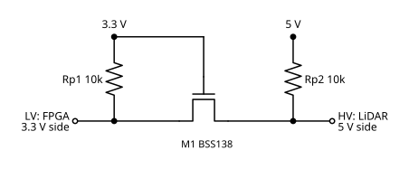

**What it does.** Connects a 3.3 V FPGA pin and a 5 V sensor pin in both directions, with one N-MOSFET per line. The gate is fixed at 3.3 V.

**How it works, in three cases:**

1. **Both sides idle (high).** The source sits at 3.3 V, so Vgs = 0 and M1 is off. Each pull-up holds its own side high: 3.3 V on the left, 5 V on the right.
2. **The FPGA pulls the 3.3 V side low.** Now Vgs = 3.3 V, more than the 0.8–1.5 V threshold, so M1 turns on and pulls the 5 V side low as well.
3. **The sensor pulls the 5 V side low.** The MOSFET's body diode (anode on the source side) conducts and pulls the 3.3 V side down to about 0.7 V. That makes Vgs large enough, M1 turns on and pulls the 3.3 V side fully low.

**Speed.** The rising edge is set by the pull-up charging the line capacitance: about 2.2·R·C = 1.3 µs with 10 kΩ and 60 pF. The simulation gives 0.9 µs on the 5 V side and 0.4 µs on the 3.3 V side, both much shorter than the 8.68 µs bit.

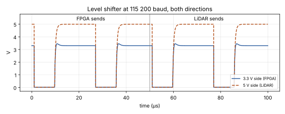

**Course link:** Topic 5, the MOSFET threshold and the MOSFET used as a switch.

## 5. Block 4: motor driver

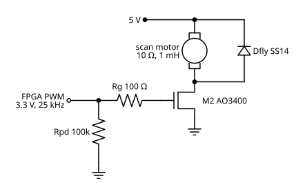

**What it does.** The FPGA's 3.3 V PWM switches a logic-level N-MOSFET on the low side of the scan motor. The motor averages the PWM, so its speed follows the duty cycle.

**Choices:**

- **Logic-level MOSFET** (AO3400): fully on at Vgs = 2.5 V, so the 3.3 V FPGA pin is enough without a gate driver.
- **25 kHz PWM**: above hearing, so the motor does not whine.
- **Rg = 100 Ω**: limits the current spike that charges the gate capacitance and damps ringing.
- **Rpd = 100 kΩ**: while the FPGA is being configured its pins float. The pull-down keeps the motor off.
- **Flyback diode** across the motor: when the MOSFET turns off, the motor's inductance keeps the current flowing. Without a path it would drive the drain voltage high enough to destroy the MOSFET. The diode clamps it at 5 V + VD = 5.26 V.

**Motor model.** 10 Ω armature, 1 mH, 2 V back-EMF. The average current is about (D·5 V − EMF) / R:

| Duty | Hand calculation | Simulation |
| --- | --- | --- |
| 0.3 | 0 mA (D·5 V is below the 2 V EMF) | 11 mA |
| 0.6 | 100 mA | 91.5 mA |
| 1.0 | 300 mA | 298 mA |

The MOSFET dissipates under 5 mW, so it needs no heatsink.

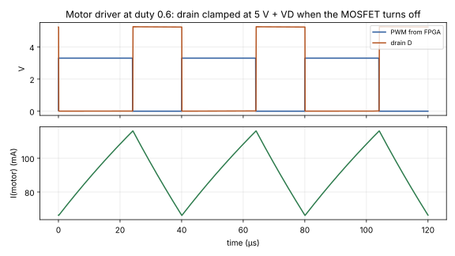

**Course link:** Topic 5 (MOSFET as a switch), Topic 6 (the coil keeps its current), Topic 11 (PWM).

## 6. Block 5: current sense

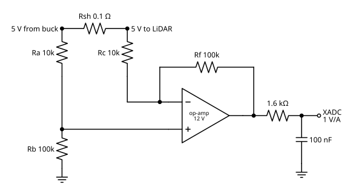

**What it does.** Measures the current the sensor draws, so the FPGA can log it and detect a stalled motor. A 0.1 Ω shunt drops 100 mV at 1 A. A difference amplifier with gain Rf/Rc = 100 k / 10 k = 10 turns this into 1 V per A, which matches the 0–1 V range of the XADC.

**Why a difference amplifier.** The shunt is on the high side, so both of its ends sit near 5 V. Only the 0–100 mV difference matters. Ra/Rb divide both inputs by 11, so the op-amp sees 4.55 V at its inputs, inside the range of an LM358 supplied from 12 V.

**Filter.** 1.6 kΩ and 100 nF form a 1 kHz low-pass filter. It removes the ripple and keeps the signal below half the sampling rate of the XADC.

**Accuracy.** The weak point of a four-resistor difference amplifier is resistor mismatch. With 1 % resistors the worst-case zero error is 182 mV, which reads as 182 mA. With 0.1 % resistors it falls to 18 mA, and the FPGA can subtract the remaining offset by reading the output once with the sensor off. An integrated current-sense amplifier (INA180) would be the other option.

**Simulation** ([`current_sense.cir`](../sim/current_sense.cir)): 0.2004 V at 0.2 A and 1.0001 V at 1 A.

**Course link:** Topic 8, the difference amplifier and the RC low-pass filter.

## 7. Verification summary

`python3 sim/run_all.py` runs every netlist and checks 32 measured values against written limits. The saved output is [`sim_results.txt`](sim_results.txt).

| Block | Checks | Status |
| --- | --- | --- |
| 1 Input protection (normal and reversed) | 5 | pass |
| 2 Buck converter, averaged model | 8 | pass |
| 2 Buck converter, switching model | 6 | pass |
| 3 Level shifter | 6 | pass |
| 4 Motor driver (duty 0.6 and 1) | 5 | pass |
| 5 Current sense | 2 | pass |

## 8. Using the netlists in LTspice

Each `.cir` file is plain SPICE, the same as the netlists LTspice writes for the course labs:

1. File → Open, set the file type to *Netlists (\*.cir)*, and open a file from `sim/`.
2. Press Run. LTspice plots the waveforms in a new window; click a node name in the netlist window to add it, or type its name with Plot Settings → Add Traces.
3. Open View → SPICE Error Log to see every `.meas` result, the same values that `run_all.py` checks.
4. To try another case, change a `.param` line, for example `.param DUTY=0.3` in `motor_driver.cir` or `.param VIN=-12` in `input_protection.cir`.

The `B` sources in some files are behavioural sources (an arbitrary expression), used as power meters and in the averaged buck model; LTspice supports them directly.

## 9. Building the board

The discrete controller of block 2 is there to show how the loop works. For a board you can build, there are two options:

- **Discrete, as simulated.** Use the parts in [`BOM.csv`](../hardware/BOM.csv). A P-MOSFET high-side switch needs a gate driver that pulls its gate down from 12 V; the comparator needs to be fast enough for 100 kHz (TLV3501, or LM393 with a stronger pull-up).
- **Integrated regulator.** A buck regulator IC contains the same blocks: reference, error amplifier, PWM comparator and switch. The LT1578 from Lab test 1 or an LM2596-5.0 can replace S1, U1, U2 and Vref; keep L1, C1 and D1, and follow the IC datasheet for the compensation. Blocks 1, 3, 4 and 5 are unchanged.

The board connects to the Nexys 4 DDR through one Pmod header (UART and PWM) and the JXADC header (current sense).

## 10. Course topic map

| Course topic | Where it appears |
| --- | --- |
| 1–2 Basic concepts, DC analysis | Feedback divider, pull-ups, power calculations |
| 3 AC analysis | LC resonance, capacitor impedance and ESR |
| 4 Diodes | Reverse-polarity diode D0, freewheeling diode D1, flyback diode, body diode in the level shifter |
| 5 MOSFETs | Level shifter, motor driver, buck switch |
| 6 DC-DC converters | The whole buck converter |
| 7 Op-amps and feedback | Error amplifier |
| 8 Op-amp applications, Bode plots | Type III compensation, loop gain plot, difference amplifier, RC filter |
| 11 Comparators and PWM | Buck PWM modulator, motor PWM |
| Lab test 1 | Buck regulator measurements: output, duty cycle, efficiency |
